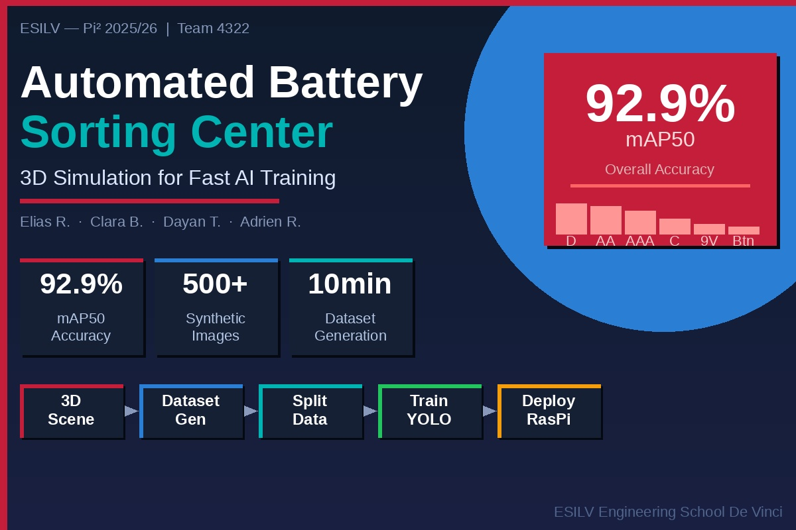
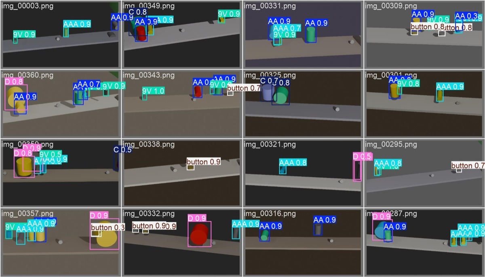

# Tri de piles par vision IA — dataset synthétique Blender + YOLOv8

Entraîner un modèle de vision demande des milliers d'images annotées à la main. Ce projet contourne le problème : une **usine de tri virtuelle modélisée dans Blender** génère automatiquement des images de piles sur un convoyeur, déjà annotées, puis un modèle **YOLOv8** est entraîné dessus et servi par une API temps réel.

Projet d'innovation en équipe de quatre (Elias R., Clara B., Dayan T., Adrien R.), école d'ingénieurs, 2025-2026.



## Résultats

| Indicateur | Valeur |
|---|---|
| mAP50 (6 classes) | **92,9 %** |
| Précision / rappel | 96,3 % / 89,1 % |
| mAP50-95 | 68,9 % |
| Dataset | 500+ images annotées générées en ~10 minutes, sans intervention manuelle |
| Classes | AA, AAA, C, D, 9V, bouton |



Le modèle livré (`weights/best.pt`) a été entraîné 50 époques. La version 3 du générateur, plus réaliste (gravité, salissures, rayures, bornes métalliques), a donné 84,4 % de mAP50 après un premier entraînement de 15 époques, à prolonger. En phase finale, le modèle a tourné sur un Raspberry Pi avec webcam pour un tri en temps réel.

Courbes d'entraînement, matrice de confusion et courbe précision-rappel : [`docs/resultats/`](docs/resultats/).

## Pipeline

| Étape | Script | Rôle |
|---|---|---|
| 1. Scène | `scene_generator.py` | Construit l'usine dans Blender : convoyeur, bacs de tri, capteurs, caméra, éclairage |
| 2. Dataset | `dataset_generator.py` | Place des piles aléatoires (simulation physique), fait varier caméra, lumière, couleurs et usure, rend l'image et calcule les boîtes englobantes au format YOLO |
| 3. Contrôle | `validate_dataset.py` | Vérifie la cohérence images / labels |
| 4. Découpage | `split_dataset.py` | Répartit en train / val / test et écrit `data.yaml` |
| 5. Entraînement | `train_yolo.py` | Fine-tune YOLOv8n |
| 6. Évaluation | `evaluate.py` | Métriques par classe et analyse des erreurs |
| 7. Démo | `backend/inference_server.py` + `frontend/` | API FastAPI (prédiction sur image ou webcam, lancement de la génération et de l'entraînement, suivi de l'entraînement en direct par WebSocket) et tableau de bord React |

Tous les paramètres (randomisation, rendu, classes, chemins) sont centralisés dans `config.py`.

## Stack

Python, Blender (bpy), Ultralytics YOLOv8, FastAPI, ONNX Runtime, React, Recharts.

## Lancer le projet

```bash
# Générer la scène puis le dataset (Blender 4+)
blender --background --python scene_generator.py
blender --background --python dataset_generator.py

# Préparer et entraîner
pip install ultralytics pyyaml
python split_dataset.py
python train_yolo.py

# Démo : API d'inférence + tableau de bord
./run_server.sh      # http://localhost:8000
./run_frontend.sh    # http://localhost:3000
```

Le modèle entraîné est fourni dans `weights/best.pt` : la démo fonctionne sans régénérer le dataset.
